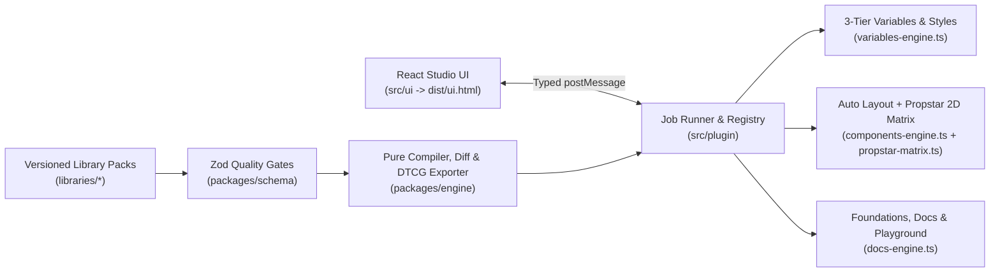

# Tokenloom — DS Forge

[](https://github.com/flukelaster/Tokenloom/actions/workflows/ci.yml)
[](./LICENSE)
[](./manifest.json)
[-059669.svg)](./SECURITY.md)

**Tokenloom (`DS Forge`)** is an open-source, deterministic **Figma Design System Generator Plugin** (`documentAccess: "dynamic-page"`, `networkAccess: ["none"]`) that compiles production-grade Design Systems directly inside Figma—complete with **3-tier Figma Variables & Light/Dark Modes**, **Propstar-style 2D Embedded Variant & Boolean Property Matrices**, **Auto Layout Components**, **Bilingual Documentation (`EN` / `TH`)**, **Three-Way Non-Destructive Updates**, and **Canonical W3C DTCG JSON Export**.

---

## Highlights

- **Propstar-Style 2D Embedded Property Matrices**:
  - Automatically arranges every multi-axis `ComponentSet` into a crisp 2D grid with **purple dashed cell dividers**, **hierarchical `#8A38F5` axis brackets**, **`#7B61FF` row/column labels**, **live `InstanceNode` Boolean property permutation quadrants**, and **zero frame clipping**.
- **3-Tier Native Figma Variable Architecture**:
  - `{Namespace}/Primitives` (`Base` mode) — Perceptual OKLCH 11-step brand ramp, neutral scale, status colors, spacing, radius, sizing, and typography primitives.
  - `{Namespace}/Semantic` (`Light` & `Dark` modes) — Cross-collection `VARIABLE_ALIAS` mappings for surfaces, text, actions, borders, feedback, and elevation.
  - `{Namespace}/Component` (`Base` mode) — Component-scoped tokens aliasing Semantic tokens so Light/Dark mode switches propagate automatically without mode duplication.
- **Modern Figma UI3 Studio Interface**:
  - Offline inline SVG brand marks for all 10 catalog libraries, live interactive Light/Dark preview stage, capability-gated brand/typography/radius/density controls, and responsive collapse from `840×680` down to `480×680`.
- **Idempotency, Three-Way Diff & Crash Recovery**:
  - Chunked `figma.root` registry (`45 KB` chunks) + per-node `ds_forge:meta` discovery.
  - Three-way comparison (`baseline` vs `live Figma` vs `target package/config`) classifying every managed object into `unchanged`, `safe-update`, `preserve-local`, `conflict` (`replace | keep | skip`), `added`, or non-destructive `[DEPRECATED]`.
  - Batch-checkpointed `RunJournal` supporting mid-run **Cancel**, **Resume**, and **Safe Artifact Cleanup**.
- **100% Offline & QuickJS Verified**:
  - Enforces `networkAccess: { allowedDomains: ["none"] }` in `manifest.json` and verifies compiled `dist/plugin.js` execution inside a bare QuickJS VM simulation on every build.

---

## Quickstart (Run in Figma Desktop)

### Prerequisites
- **Node.js** `>= 20` and **pnpm** `>= 9`
- **Figma Desktop** with a file inside a **Professional, Organization, or Education** team (required by Figma to create 2+ Variable modes `Light` + `Dark`; Figma Starter restricts collections to a single mode)

### 1. Clone & Build

```bash
git clone https://github.com/flukelaster/Tokenloom.git
cd Tokenloom
pnpm install
pnpm build
```

This generates two self-contained bundles:
- `dist/plugin.js` — Sandboxed Figma `dynamic-page` runtime
- `dist/ui.html` — Single-file React Studio UI (all CSS & SVG icons/logos bundled inline)

### 2. Import into Figma Desktop

1. Open **Figma Desktop** and open a Design file.
2. Navigate to **Plugins → Development → Import plugin from manifest…**
3. Select [`manifest.json`](./manifest.json) from the repository root.
4. Launch via **Plugins → Development → DS Forge — Design System Generator**.

---

## Architecture Overview



---

## Library Catalog & Quality Gate Status

Generation unlocks exclusively for library adapters that pass schema, token-alias graph, WCAG recipe contrast, and license provenance Quality Gates (`pnpm audit:packages`).

| # | Library | Status | Upstream License | Coverage |
|---|---|---|---|---|
| 01 | **shadcn/ui** | `Ready` | `MIT` | 15 Core families + 8 helper icons + 3 composed patterns |
| 02 | **Ant Design (v5)** | `Ready` | `MIT` | 10 Core families + Seed/Map/Component tokens + Default/Compact density |
| 03 | **Material UI Core (v6)** | `Ready` | `MIT` (Core only) | 10 Core families + `palette`/`shape` CSS variable syntax |
| 04 | **Carbon Design System (v11)** | `Beta` | `Apache-2.0` (`NOTICE` preserved) | 6 Core families + White/G100 layer tokens |
| 05 | Chakra UI | `Roadmap` | `MIT` | Provenance manifest registered (locked by Quality Gate) |
| 06 | Mantine | `Roadmap` | `MIT` | Provenance manifest registered (locked by Quality Gate) |
| 07 | HeroUI (MIT Core) | `Roadmap` | `MIT` | Provenance manifest registered (locked by Quality Gate) |
| 08 | Radix Themes | `Roadmap` | `MIT` | Provenance manifest registered (locked by Quality Gate) |
| 09 | Fluent UI Web v9 | `Roadmap` | `MIT` | Provenance manifest registered (locked by Quality Gate) |
| 10 | Material Web (M3) | `Roadmap` | `Apache-2.0` | Provenance manifest registered (locked by Quality Gate) |

---

## Workspace Structure

```text
├── manifest.json                 # Figma plugin manifest (dynamic-page, networkAccess: ["none"])
├── packages/
│   ├── schema/                   # Zod schemas, capability matrix, registry types & Quality Gate
│   └── engine/                   # Perceptual OKLCH ramp, compiler, 3-way diff & DTCG JSON exporter
├── libraries/                    # Clean-room library adapters & upstream license provenance
├── src/
│   ├── shared/                   # Strictly typed UI <-> Plugin message protocol
│   ├── plugin/                   # Figma dynamic-page runtime + Propstar 2D matrix layout engine
│   └── ui/                       # React 19 single-file Studio UI + inline SVG library brand logos
├── fixtures/                     # Golden regression summary fixtures
├── scripts/                      # esbuild bundler, package auditor & QuickJS VM release checker
└── tests/                        # Stateful Figma mock runtime, Vitest suites & Playwright E2E tests
```

---

## Development & Verification Scripts

```bash
# Start standalone browser Studio UI with interactive simulation bridge
pnpm dev:ui

# Type-check shared packages, plugin sandbox runtime, and React UI
pnpm typecheck

# Audit all 10 catalog packages against schema, alias graph, and license gates
pnpm audit:packages

# Run Vitest unit & stateful Figma pipeline integration tests
pnpm test

# Run Playwright Chromium E2E UI tests (840x680 & 480x680 viewports)
pnpm test:ui

# Full production gate (typecheck + audit + vitest + build + QuickJS release check)
pnpm verify
```

---

## Contributing

Contributions—especially new clean-room library adapters, component recipes, localization improvements, and Figma layout refinements—are very welcome! Please read [CONTRIBUTING.md](./CONTRIBUTING.md) and our [Code of Conduct](./CODE_OF_CONDUCT.md) before opening a pull request.

---

## License & Provenance

Released under the [MIT License](./LICENSE). See [NOTICE](./NOTICE) for clean-room design token and upstream open-source attribution details.
