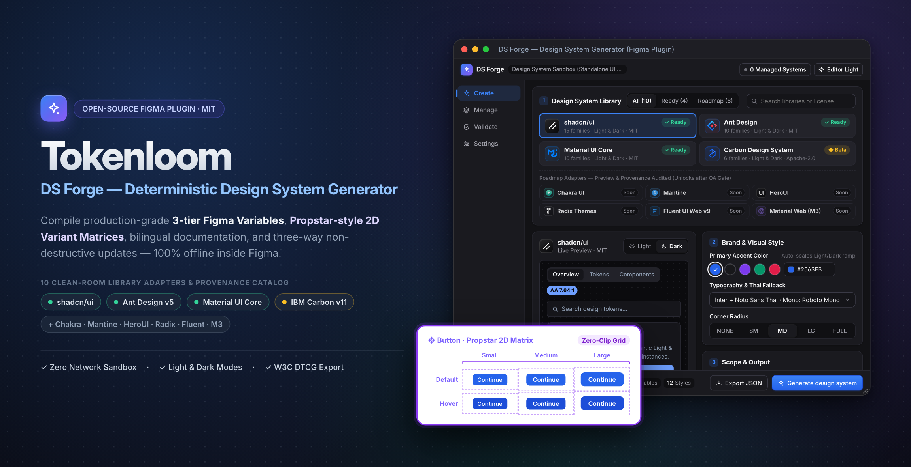
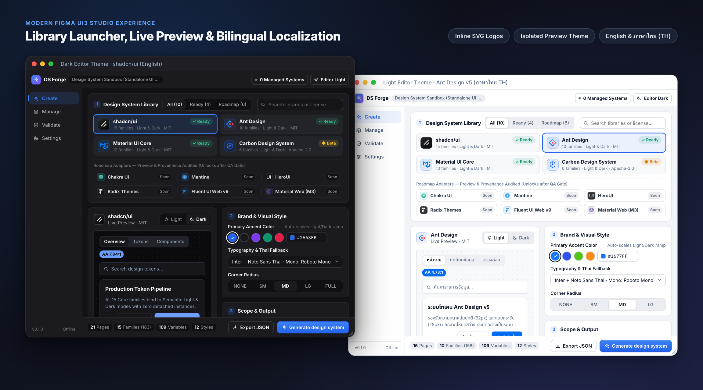
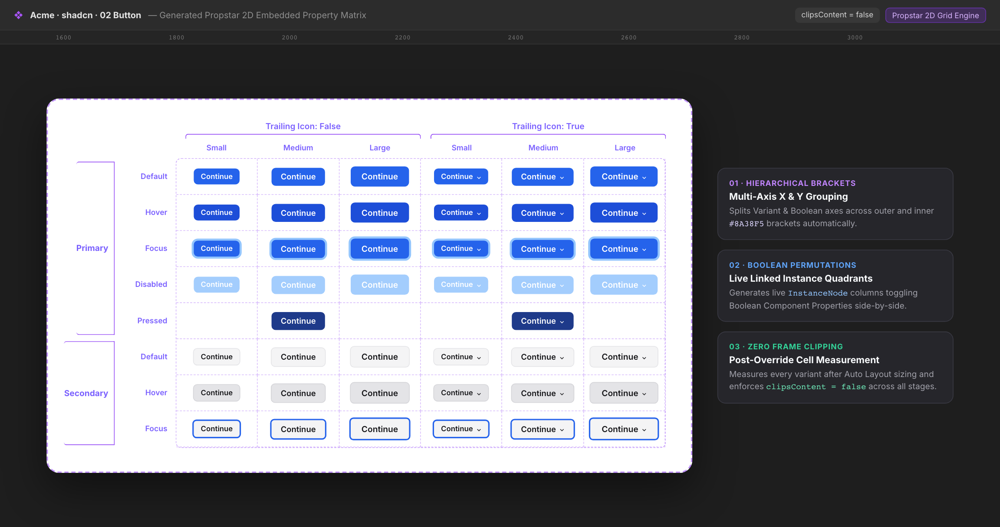
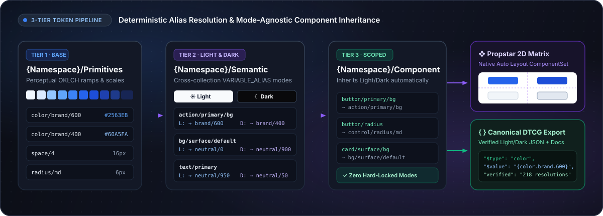
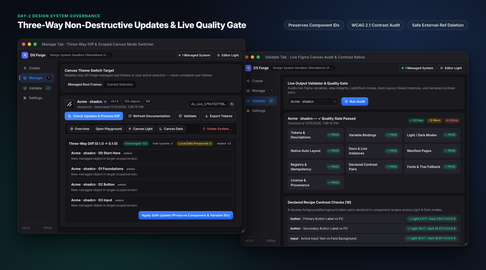
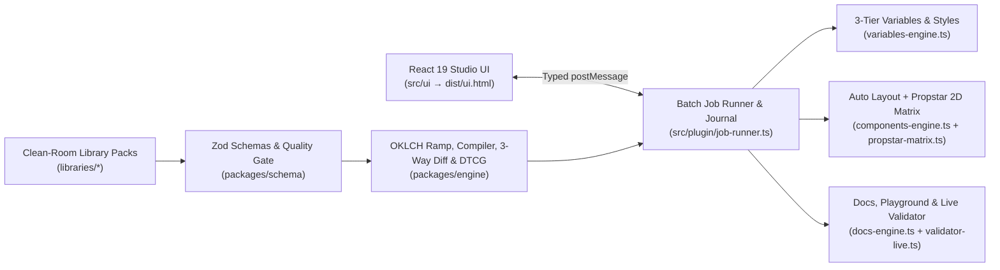

<div align="center">



<br />

# Tokenloom · DS Forge

**Deterministic, Open-Source Figma Design System Compiler**
Generate native **3-tier Figma Variables**, **Propstar-style 2D Variant Matrices**, **Bilingual Documentation (`EN` / `TH`)**, and **Non-Destructive Three-Way Updates** — 100% offline inside Figma.

<p>
  <a href="https://github.com/flukelaster/Tokenloom/actions/workflows/ci.yml"></a>
  <a href="./LICENSE"></a>
  <a href="./manifest.json"></a>
  <a href="./SECURITY.md"></a>
  <a href="./tsconfig.json"></a>
  <a href="./CONTRIBUTING.md"></a>
</p>

<p>
  <a href="https://github.com/flukelaster/Tokenloom/releases/latest"></a>
</p>

<p>
  <a href="#quickstart">Quickstart</a> •
  <a href="#visual-tour">Visual Tour</a> •
  <a href="#variable-architecture">3-Tier Variables</a> •
  <a href="#library-catalog">Library Catalog</a> •
  <a href="#figma-blueprint">Page Blueprint</a> •
  <a href="#development">Development</a> •
  <a href="./CONTRIBUTING.md">Contributing</a>
</p>

</div>

---

## Why Tokenloom?

Static Figma UI kits go stale the moment your brand color, corner radius, density, or token naming changes—and re-importing a kit breaks component links across every product file.

**Tokenloom (`DS Forge`)** treats a Figma Design System as a **deterministic build artifact** compiled from clean-room, versioned library specifications:

| Capability | Static Community UI Kits | Tokenloom (`DS Forge`) |
|---|---|---|
| **Brand & Radius Customization** | Manual find-and-replace across hundreds of layers | **Perceptual OKLCH 11-step ramp** + live radius/font/density compilation |
| **Component Variant Layout** | Cramped horizontal strips or clipped frames | **Propstar-style 2D Embedded Matrices** with `#8A38F5` brackets & zero clipping |
| **Light & Dark Mode Switching** | Duplicated components per theme | **3-Tier `VARIABLE_ALIAS` inheritance** — zero hard-locked component modes |
| **Day-2 Library Upgrades** | Destructive copy-paste that breaks `InstanceNode` links | **Three-Way Non-Destructive Diff** preserving Figma Variable & Component IDs |
| **Privacy & Enterprise Security** | Cloud-dependent SaaS accounts & external telemetry | **`networkAccess: ["none"]`** — 100% local execution inside Figma's QuickJS VM |

---

<a id="visual-tour"></a>

## ✨ Visual Tour

### 1. Modern Figma UI3 Studio & Bilingual Localization (`EN` / `TH`)

Designed for speed and clarity from `840×680` two-column studio mode down to `480×680` single-column compact mode. Browse **10 library adapters with inline SVG brand marks**, tweak brand palettes, typography, corner radius, and component scope above the fold, and preview **Light / Dark** token behavior independently of your Figma Editor theme—in **English (`en`)** or **Thai (`th`)**.

<p align="center">
  
</p>

---

### 2. Propstar-Style 2D Embedded Property Matrices & Zero-Clip Layout

Instead of dumping variants into flat horizontal strips, DS Forge's built-in **Propstar 2D Matrix Engine** (`src/plugin/propstar-matrix.ts`) organizes every multi-axis `ComponentSet` into a structured, readable specification table directly on the canvas:

- **Hierarchical `#8A38F5` Brackets & `#7B61FF` Labels** — Automatically partitions Variant axes (`Variant`, `State`, `Size`) across Y-rows and X-columns.
- **Boolean Property Permutation Quadrants** — Generates live linked `InstanceNode` quadrants toggling Boolean Component Properties (`Trailing Icon: False / True`, etc.) side-by-side.
- **Post-Override Measurement & `clipsContent = false`** — Measures every rendered variant after Auto Layout sizing so wide surface components (`Card`, `Alert`, `Table`, `Dialog`) never clip or overlap.

<p align="center">
  
</p>

---

<a id="variable-architecture"></a>

### 3. 3-Tier Native Variable Architecture & Canonical DTCG Export

Every generated system builds three isolated, namespace-scoped Figma Variable collections wired via native `VARIABLE_ALIAS` references, paired with localized descriptions (**When to use / Avoid / Example / Constraints**), Figma `VariableScope` rules, `WEB` `codeSyntax`, and **W3C DTCG JSON export** verified by an independent Light/Dark resolver:

<p align="center">
  
</p>

---

### 4. Day-2 Governance: Three-Way Diff & Live 10-Category Quality Gate

Updating an existing Design System never wipes out your team's work:

- **Three-Way Diff Engine (`baseline` vs `live Figma` vs `next`)** — Classifies every Variable, Style, and Component into `unchanged`, `safe-update`, `preserve-local`, `conflict` (with per-object `Keep` / `Replace` / `Skip` resolution), `added`, or non-destructive `[DEPRECATED]`.
- **Preserved `Custom Notes`** — Refreshing documentation updates live token tables and component instances while keeping team-authored notes intact.
- **Live Output Validator** — Audits live Figma Variables, alias chains, Light/Dark mode inheritance, Auto Layout sizing, linked instances, and **WCAG 2.1 declared foreground/background contrast ratios**.

<p align="center">
  
</p>

---

<a id="quickstart"></a>

## 🚀 Quickstart

### Prerequisites
- **Node.js** `>= 20.0.0` and **pnpm** `>= 9.0.0`
- **Figma Desktop** with a Design file inside a **Professional, Organization, or Education** team
  *(Figma Starter restricts Variable collections to 1 mode; DS Forge runs a clean zero-residue preflight probe before creating `Light` + `Dark` modes).*

### Option A — Download prebuilt (no Node.js needed)

1. Download `tokenloom-ds-forge-vX.Y.Z.zip` from the [latest Release](https://github.com/flukelaster/Tokenloom/releases/latest) and unzip it.
2. Jump to [Import into Figma Desktop](#2-import-into-figma-desktop) and select the unzipped `manifest.json`.

> ⚠️ Don't use GitHub's **"Source code (zip)"** — it has no `dist/` folder, and Figma will show *"An error occurred while loading the plugin environment"*.

### Option B — Build from source

### 1. Clone, Install & Build

```bash
git clone https://github.com/flukelaster/Tokenloom.git
cd Tokenloom
pnpm install
pnpm build
```

This compiles two self-contained, zero-network production artifacts:
- `dist/plugin.js` — Sandboxed Figma `dynamic-page` QuickJS runtime
- `dist/ui.html` — Single-file React 19 Studio UI (all CSS, icons & library brand SVGs bundled inline)

### 2. Import into Figma Desktop

1. Open **Figma Desktop** and open any Design file.
2. Go to **Plugins → Development → Import plugin from manifest…**
3. Select [`manifest.json`](./manifest.json) at the root of this repository.
4. Launch **Plugins → Development → DS Forge — Design System Generator**.

---

<a id="figma-blueprint"></a>

## 📐 Generated Figma Blueprint

Each Design System instance generates a manifest-ordered page hierarchy isolated under your chosen `{Namespace}`:

| Page Order | Page Name Example | Contents |
|---|---|---|
| `00` | `Acme · shadcn · 00 Start Here` | System overview, namespace metadata, token counts, and quick onboarding guide |
| `01` | `Acme · shadcn · 01 Foundations` | Live color ramps, Light/Dark semantic swatches, spacing/radius scales & typography specimens |
| `02..NN` | `Acme · shadcn · 02 Button` … `16 Tabs` | Propstar 2D `ComponentSet` stage + live linked `InstanceNode` examples + preserved `Custom Notes` |
| `90` | `Acme · shadcn · 90 Patterns` | Composed multi-component UI patterns (e.g., Auth Form, Settings Card, Confirmation Modal) |
| `91` | `Acme · shadcn · 91 Theme Playground` | Side-by-side explicit **Light** and **Dark** live preview frames demonstrating instant mode inheritance |
| `98` | `Acme · shadcn · 98 Quality Report` | Automated 10-category acceptance report + WCAG contrast table + capability exception log |
| `99` | `Acme · shadcn · 99 Changelog & License` | Version history, clean-room provenance manifest, and full `MIT` / `Apache-2.0` `NOTICE` attribution |

---

<a id="library-catalog"></a>

## 📚 Library Catalog

Generation unlocks **exclusively** for library packages that pass schema validation, acyclic token-alias resolution, WCAG contrast checks, and SPDX license provenance audits (`pnpm audit:packages`).

| # | Library Adapter | Status | SPDX License | Coverage |
|---|---|---|---|---|
| 01 | **shadcn/ui** | `✓ Ready` | `MIT` | 15 Core component families + 8 vector helper icons + 3 composed patterns |
| 02 | **Ant Design (v5)** | `✓ Ready` | `MIT` | 10 Core families + Seed/Map/Component semantics + `Default` & `Compact` density |
| 03 | **Material UI Core (v6)** | `✓ Ready` | `MIT` *(Core only)* | 10 Core families + `palette` / `shape` CSS variable syntax (excludes MUI X Pro) |
| 04 | **Carbon Design System (v11)** | `◆ Beta` | `Apache-2.0` | 6 Core families + White/G100 layer tokens + preserved `NOTICE` & modification log |
| 05 | Chakra UI (v3) | `Roadmap` | `MIT` | Provenance manifest audited (locked by Quality Gate until Core recipes complete) |
| 06 | Mantine (v7) | `Roadmap` | `MIT` | Provenance manifest audited (locked by Quality Gate) |
| 07 | HeroUI *(MIT Core)* | `Roadmap` | `MIT` | Provenance manifest audited (strictly excludes HeroUI Pro) |
| 08 | Radix Themes (v3) | `Roadmap` | `MIT` | Provenance manifest audited (scoped to Radix Themes) |
| 09 | Fluent UI Web v9 | `Roadmap` | `MIT` | Provenance manifest audited (scoped to `@fluentui/react-components`) |
| 10 | Material Web (M3) | `Roadmap` | `Apache-2.0` | Provenance manifest audited (`--md-sys-color-*` & `--md-ref-palette-*`) |

---

## 🏗 System Architecture & Monorepo Layout



```text
Tokenloom/
├── manifest.json                 # Figma plugin manifest (dynamic-page, networkAccess: ["none"])
├── packages/
│   ├── schema/                   # Zod schemas, binding capability matrix & package Quality Gate
│   └── engine/                   # OKLCH color scale, compiler, 3-way diff & W3C DTCG exporter
├── libraries/                    # Clean-room library adapters (shadcn, antd, mui, carbon, roadmap)
├── src/
│   ├── shared/                   # Strictly typed UI <-> Plugin message protocol
│   ├── plugin/                   # Figma sandbox runtime, chunked registry & Propstar 2D matrix engine
│   └── ui/                       # Single-file Studio UI, simulation bridge & inline SVG brand logos
├── docs/assets/                  # Hero cover, studio showcases & vector architecture diagrams
├── fixtures/                     # Canonical golden regression fixtures
├── scripts/                      # esbuild bundler, package auditor & QuickJS VM release checker
└── tests/                        # Stateful Figma dynamic-page mock, Vitest suites & Playwright E2E
```

---

<a id="development"></a>

## 🛠 Development & Verification

| Command | Description |
|---|---|
| `pnpm dev:ui` | Launch standalone Studio UI in browser (`http://localhost:5173`) with interactive simulation bridge |
| `pnpm build` | Build production `dist/ui.html` (single-file) and `dist/plugin.js` (QuickJS bundle) |
| `pnpm typecheck` | Run strict TypeScript checks across shared packages, plugin runtime, and React UI |
| `pnpm audit:packages` | Audit all 10 catalog libraries against schema, alias graph, contrast, and license gates |
| `pnpm test` | Run Vitest unit & stateful Figma pipeline integration suites (`24/24` tests) |
| `pnpm test:ui` | Run Playwright Chromium E2E tests across `840×680` and `480×680` viewports |
| `pnpm verify` | Run full CI release gate (`typecheck` + `audit:packages` + `test` + `build` + QuickJS VM check) |

---

## 🤝 Contributing & Security

We welcome pull requests for new clean-room library adapters, component recipes, localization languages, and Figma layout enhancements!

- Read our **[Contributing Guide](./CONTRIBUTING.md)** to set up your environment and learn how to author a new library adapter.
- Review our **[Security Policy](./SECURITY.md)** (strictly offline `networkAccess: ["none"]` sandbox) and **[Code of Conduct](./CODE_OF_CONDUCT.md)**.

---

## 📄 License

Distributed under the **[MIT License](./LICENSE)**. See **[NOTICE](./NOTICE)** for clean-room design token and upstream open-source license attributions.
