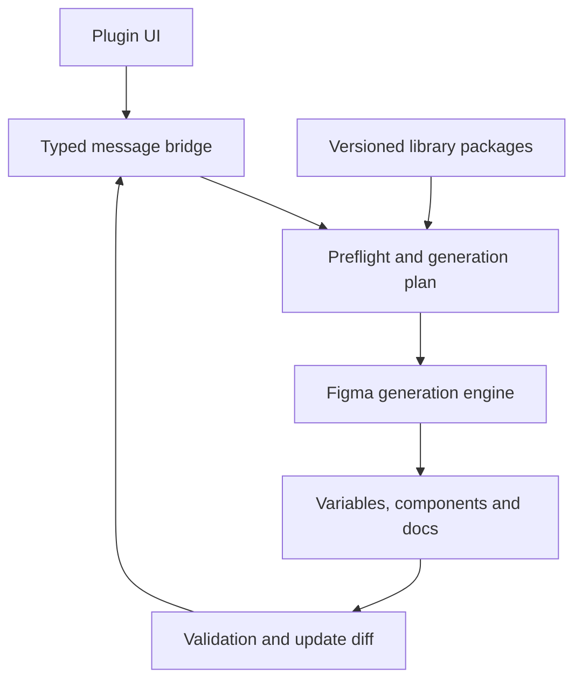

# Figma Design System Generator — Implementation Plan

วันที่: 15 พฤศจิกายน 2026  
สถานะ: แผนสำหรับเริ่มพัฒนา ยังไม่ใช่ Plugin ที่พัฒนาแล้ว  
ชื่อชั่วคราว: DS Forge  
รูปแบบผลิตภัณฑ์: Figma Design Plugin สำหรับสร้าง Design System แบบ Native และแก้ไขต่อได้

## 1. เป้าหมายผลิตภัณฑ์

ผู้ใช้เลือก Library ตั้งต้น เลือกค่าของแบรนด์ แล้วกด Generate ครั้งเดียว เพื่อสร้าง Design System ในไฟล์ Figma ปัจจุบัน ประกอบด้วย:

- Native Components และ Component Sets ที่ใช้ Auto Layout และ Component Properties อย่างเหมาะสม
- Primitive, Semantic และ Component Token Variables พร้อม Alias ที่ตรวจสอบได้
- Light/Dark Modes ที่สลับแล้ว Components และตัวอย่างเปลี่ยนตามจริง
- Description การใช้งานของ Variables ทุกตัว
- เอกสารการใช้งานแต่ละ Component และตัวอย่างที่สร้างจาก Instances ของ Component จริง
- Page แยกตาม Component พร้อม Foundations, Patterns และหน้าเริ่มต้น
- ระบบ Validate และ Update ที่รักษา Component identity และไม่สร้างรายการซ้ำเมื่อรันซ้ำ

ในแผนนี้ตีความคำว่า “ผูกกับ comment” จากความต้องการเดิมว่าหมายถึง “ผูกกับ component” หากหมายถึง Figma Comments จริง ต้องแยกเป็นฟีเจอร์เพิ่มเติม ไม่รวมอยู่ในขอบเขตนี้

**ความหมายของ One click:** หลังเลือก Library และใช้ค่า Default ที่พร้อมแล้ว สามารถกด Generate ได้ทันที โดย Advanced settings เป็นทางเลือก ไม่ต้องตั้งค่าทุกครั้ง

## 2. ขอบเขตและข้อจำกัด

### รวมในผลิตภัณฑ์

- Catalog เป้าหมาย 10 Libraries แต่เปิดให้ Generate เฉพาะแพ็กที่ผ่าน Quality gate
- Generation แบบกำหนดผลลัพธ์ได้จาก Versioned Library Definition
- สร้าง Components ใหม่จาก Definition และแหล่งที่มีสิทธิ์ใช้งาน ไม่ใช้การคัดลอก Figma Kit ที่ยังไม่มีสิทธิ์
- สร้างในไฟล์ปัจจุบัน แยก Namespace และ Package identity
- Presets สำหรับสีแบรนด์ Font และ Radius เท่าที่ Adapter รองรับ
- เลือกชุด Core หรือ Full ตามรายการ Components ที่แพ็กนั้นรองรับ
- รายงานคุณภาพและรายละเอียดส่วนที่ยังไม่รองรับ
- JSON token export พร้อม Theme manifest และข้อมูลแหล่งที่มา

### ไม่รวมในรุ่นแรก

- การแปลง Library จาก URL ใดก็ได้โดยอัตโนมัติ
- AI สร้าง Component หรือ Token แบบอิสระระหว่าง Generate
- การ Publish Team Library อัตโนมัติ ให้ผู้ใช้ตรวจและ Publish ผ่าน Figma
- การสร้างไฟล์ Figma ใหม่หรือย้ายข้ามไฟล์โดยอัตโนมัติ
- การรับประกันความตรงกับ Runtime code ทุกพฤติกรรม เช่น Keyboard interaction และ Validation logic
- การ Swap ระบบจาก shadcn เป็น Ant Design ให้กับงานออกแบบเดิมโดยอัตโนมัติ
- การ Sync สองทางกับ Code repository

Generation ไม่จำเป็นต้องใช้ LLM: คุณภาพหลักมาจาก Metadata และ Recipes ที่ตรวจแล้ว หากเพิ่ม AI ภายหลัง ให้ใช้ร่างเอกสารหรือเสนอ Mapping แล้วผ่านการตรวจ ก่อนออกเป็น Library Definition รุ่นใหม่

## 3. Library Catalog เป้าหมาย

| ลำดับพัฒนา | Library | แหล่งตั้งต้น | License ของโค้ดที่ตรวจพบ | ข้อกำหนดสำคัญ |
| --- | --- | --- | --- | --- |
| 1 | shadcn/ui | shadcn-ui/ui | MIT | สร้าง Figma Recipe เอง และ Pin เวอร์ชันต้นฉบับ |
| 2 | Ant Design | ant-design/ant-design | MIT | รักษา Global/Component token mapping |
| 3 | Material UI Core | mui/material-ui | MIT | ไม่รวม Pro/Premium หรือ Paid design assets |
| 4 | Chakra UI | chakra-ui/chakra-ui | MIT | รักษา Semantic token roles |
| 5 | Mantine | mantinedev/mantine | MIT | แยกข้อกำหนดของ Components ที่ซับซ้อน |
| 6 | HeroUI | heroui-inc/heroui | MIT | ไม่รวม HeroUI Pro โดยปริยาย |
| 7 | Radix Themes | radix-ui/themes | MIT | รองรับ Themes ไม่อ้างว่าเป็น Primitives ทั้งระบบ |
| 8 | Fluent UI Web | microsoft/fluentui | MIT | ระบุ Platform และ Version ไม่รวมทุก Fluent asset |
| 9 | Carbon | carbon-design-system/carbon | Apache 2.0 | รักษา Theme/layer semantics และ Notices |
| 10 | Material Web | material-components/material-web | Apache 2.0 | ใช้ชื่อที่บอกแหล่งชัด ไม่อ้างสิทธิ์ครอบคลุม Material Design ทุก Asset |

รายการนี้เป็น Roadmap ไม่ใช่การรับรองสิทธิ์ของ Figma Kits ทั้ง 10 เจ้า ตรวจ Artifact จริงที่นำเข้าและ Dependencies ก่อนเปิดแต่ละแพ็ก เอกสารที่แปลหรือดัดแปลงต้องมี Provenance เช่นเดียวกับโค้ด ส่วน Fonts, Icons, Logos และภาพใช้ License แยก

เก็บ source repository, commit/tag, file paths, license text, copyright notices, NOTICE หากมี, และรายการแก้ไขของ Apache sources ในแต่ละแพ็ก ไม่ระบุว่า Plugin เป็น Official partner หรือใช้ Logo โดยไม่มีฐานสิทธิ์

## 4. ประสบการณ์ใช้งานและ Visual Direction

### 4.1 หน้าตา Plugin

- รูปแบบ Modern utility: พื้นผิวเรียบ Typography ชัด ระยะห่างสม่ำเสมอ และให้ Preview เป็นจุดเด่น
- ขนาดเริ่มต้นที่เสนอ 840 × 680 px ปรับขนาดได้ และมี Single-column layout ที่ความกว้าง 480 px
- Sidebar ขนาดประมาณ 160 px สำหรับ Create, Manage, Validate และ Settings; ยุบเป็น Tabs เมื่อหน้าต่างแคบ
- Light/Dark ของตัว Plugin ตาม Figma editor theme ส่วน Preview theme ของ Library เป็นอีกค่าหนึ่ง แยกกันชัดเจน
- ใช้สี Accent หนึ่งสีเป็นหลัก Surface 3 ระดับ Border บาง Radius 8–12 px และ Spacing scale 4/8 px
- ใช้ตัวอักษรสำหรับ UI 12–14 px หัวข้อ 18–20 px; ข้อมูลเทคนิคที่ยาวตัดบรรทัดและมี Copy action
- มี Keyboard focus, Label, Error text และ Status ที่ไม่พึ่งสีอย่างเดียว
- Motion สั้น 120–180 ms ใช้เฉพาะการเปลี่ยนสถานะ และเคารพ Reduced motion
- ไม่ใส่ Gradient หรือ Glass effect จนลด Contrast หรือความชัดของตัวอย่าง

### 4.2 หน้า Create

ส่วนบน: ชื่อ Plugin, คำอธิบายหนึ่งบรรทัด และรายการ Design Systems ที่ติดตั้งในไฟล์นี้

Library cards แสดงชื่อ แหล่งที่มา รุ่นแพ็ก จำนวน Component families ที่รองรับ Light/Dark และสถานะ Ready/Beta/Coming soon โดยไม่ใช้จำนวนที่ Hardcode แยกจาก Package manifest

เลือก Library แล้วแสดงรายละเอียด:

| ส่วน | Controls |
| --- | --- |
| Preview | ตัวอย่าง Button, Input, Card, Navigation; Light/Dark toggle |
| Brand | Brand color, Font, Radius เฉพาะค่าที่ Adapter รองรับ |
| Scope | Core / Full / Custom component selection |
| Output | Namespace, Documentation language, Page naming |
| Advanced | Density เฉพาะแพ็กที่รองรับ, Token prefix, Strict fidelity / Brand customization |
| Footer | จำนวน Pages/Variants/Variables โดยประมาณ, Warnings และ Generate design system |

Default ต้องสร้างได้ทันที: Core components, Light/Dark, เอกสารภาษาอังกฤษ, Namespace ตาม Library; ผู้ใช้เลือกภาษาไทยได้ตั้งแต่รุ่นแรกของแพ็กต้นแบบ โดยข้อความไทยต้องผ่านการตรวจและใช้ Font fallback ที่รองรับไทย

Preview ระยะแรกใช้ภาพหรือ Snapshot ที่สร้างจาก Canonical fixture เวอร์ชันเดียวกับ Recipe และแสดงค่าแบรนด์ที่รองรับ เมื่อค่าใด Preview ยังจำลองไม่ครบต้องบอกตรงนั้น การ Preview ใน HTML ไม่ถือเป็นหลักฐานว่า Figma output ถูกต้อง

### 4.3 Generate และผลลัพธ์

State flow: Configure → Preflight → Generate → Validate → Complete หรือ Partial/Failed/Cancelled

- แสดง Stage และจำนวนงานที่เสร็จ เช่น Components 8/20 ไม่แสดงเปอร์เซ็นต์ที่แต่งขึ้น
- แสดงรายการปัจจุบันและปุ่ม Cancel ที่ทำงานระหว่าง Batch
- เมื่อเสร็จ มี Open overview, Go to components, View validation report และ Export tokens
- หากมีข้อผิดพลาด แสดงสิ่งที่สร้างสำเร็จ สิ่งที่ไม่สำเร็จ และทางเลือก Resume/Retry/Clean up เฉพาะงานรอบนี้
- ไม่ปิด Plugin จนกว่างาน Async และการสรุปสถานะจะเสร็จ

### 4.4 หน้า Manage

แสดง Design System instances ภายในไฟล์ พร้อม Library version, Generator version, วันที่ Generate และสถานะ Local changes มี Actions: Check updates, Preview diff, Apply update, Validate, Switch generated preview theme และ Export

Theme switch นี้เปลี่ยนเฉพาะ Root ที่ Plugin จัดการหรือ Selection ที่ผู้ใช้เลือก ไม่เปลี่ยนทุก Frame ในไฟล์โดยปริยาย

## 5. โครงสร้างไฟล์ Figma ที่สร้าง

ตัวอย่างสำหรับ Namespace `Acme · shadcn`:

| Page | เนื้อหา |
| --- | --- |
| Acme · 00 Start Here | รุ่น Library, Quick start, วิธี Theme swap, ขอบเขตที่รองรับ และ License |
| Acme · 01 Foundations | Color, Typography, Spacing, Radius, Elevation, Token architecture |
| Acme · 02 Button | Main components, Variants, Docs, Examples |
| Acme · 03 Input | Main components, States, Docs, Examples |
| Acme · 04 Checkbox | Main components, States, Docs, Examples |
| Acme · … | หนึ่ง Page ต่อหนึ่ง Component family |
| Acme · 90 Patterns | Login form, Settings form, Table toolbar เป็นต้น |
| Acme · 91 Theme Playground | ตัวอย่าง Light/Dark แบบวางคู่กัน |
| Acme · 98 Quality Report | ข้อผิดพลาด คำเตือน และ Coverage |
| Acme · 99 Changelog & License | Sources, Notices, Version history และรายการดัดแปลง |

ลำดับ Page ใช้ Manifest กำหนด ไม่ใช้ลำดับเวลาที่สร้าง ตั้งชื่อ Main components แบบ `Button` และ Variants เช่น `Variant=Primary, Size=Medium, State=Default`

Docs sections: Overview → Anatomy → Properties → Variants → States → Token mapping → Examples → Do/Don't → Accessibility → Version/source

ตัวอย่างบน Docs ใช้ Instances ที่เชื่อมกับ Main components จริง แต่ข้อความ Snapshot เช่นตารางค่า Token จะมีคำสั่ง Refresh documentation และระบุเวลาที่ Refresh ไม่อ้างว่า Sync อัตโนมัติหลังผู้ใช้แก้เอง

## 6. Token Architecture

### 6.1 Collections และ Modes

| Collection | Modes | หน้าที่ |
| --- | --- | --- |
| `{namespace}/Primitives` | Base | Raw palette, Spacing, Radius, Type scale |
| `{namespace}/Semantic` | Light, Dark | Surface, Text, Border, Action, Feedback |
| `{namespace}/Component` | Base | Component-specific aliases ไป Semantic หรือ Primitives |

Component collection ใช้ Base mode เดียวได้ โดยค่า Alias จะ Resolve ผ่าน Mode ของ Semantic collection ที่ใช้บน Frame นั้น ต้องทดสอบข้าม Collections จริงก่อนกำหนดเป็นมาตรฐาน ห้ามสร้าง Light/Dark ซ้ำทุก Collection โดยไม่จำเป็น

ตัวอย่างความสัมพันธ์:

```text
Button fill → component/button/primary/background
            → semantic/action/primary/background
            → primitive/color/brand/600   [Light]
            → primitive/color/brand/400   [Dark]
```

### 6.2 ข้อมูลบังคับต่อ Token

- Stable logical ID ซึ่งไม่เปลี่ยนตาม Display name
- Source token name, Semantic role, Type และค่าหรือ Alias ตาม Mode
- Description ภาษาเอกสารที่เลือก: ใช้เมื่อไร, ไม่ควรใช้เมื่อไร, ตัวอย่าง และข้อจำกัด
- Allowed scopes ตามที่ API รองรับ และ Code syntax ตาม Ecosystem เมื่อมี Mapping ที่ถูกต้อง
- Source version, License provenance, Deprecated/replacement metadata
- Token category และ Binding targets ที่คาดหวัง

ตัวอย่าง Description:

> ใช้กับข้อความประกอบและ Metadata บนพื้นผิวมาตรฐาน ห้ามใช้แทนข้อความ Disabled หรือ Error เปลี่ยนค่าตาม Semantic Light/Dark mode ตรวจ Contrast กับพื้นหลังที่ใช้งานจริง

### 6.3 Fidelity และค่าที่ไม่ใช่ Variable โดยตรง

- ไม่บังคับทุก Library ให้ใช้ชื่อ Semantic เดียวกัน เก็บชื่อและ Layering ของต้นฉบับ พร้อม Normalized role สำหรับ Engine
- ใช้ Text styles สำหรับ Typography และ Effect styles สำหรับ Elevation ตามความสามารถของ Figma; ผูกค่าภายในกับ Variables เฉพาะที่ API รองรับจริง
- จัดทำ Capability matrix ตาม Node/property และทดสอบกับ Plugin typings รุ่นที่ Pin
- ค่าที่ Bind ไม่ได้ต้องมีเหตุผลในรายงาน เช่น Static icon geometry ไม่ใช้คำรับประกันว่า “ทุกค่าผูก Variable 100%”
- แยก Theme mode ออกจาก Density และ Brand ไม่ทำ Cartesian product จน Modes ระเบิด
- Brand customization ต้องเปลี่ยนทั้ง Palette/roles ที่เกี่ยวข้อง พร้อม State และ Contrast checks ไม่เปลี่ยน Primary hex ตัวเดียวแล้วถือว่าเสร็จ
- Core structure ต้องไม่มี Alias cycle, Type mismatch, Missing mode หรือ Dangling alias

## 7. Component Architecture

ใช้ Recipes แบบประกาศโครงสร้างที่ Engine อ่านได้ มี Nodes, Layout, Slots, Variants, Properties และ Token bindings ไม่ใช้ Screenshot เป็น Component

- ใช้ Auto Layout สำหรับ Container, Content, Label และ Icon slots ตาม Anatomy
- ใช้ Boolean property สำหรับการแสดง Icon/Text ที่ไม่จำเป็นต้องเพิ่ม Variant
- ใช้ Text property สำหรับ Label/Placeholder และ Instance swap สำหรับ Icon หรือ Nested component
- ใช้ Variant เฉพาะแกนที่เปลี่ยนโครงสร้างหรือหน้าตาจริง ลด Variant explosion
- ไม่ผสม Light/Dark เข้าเป็น Component variants ให้ Mode จัดการ
- แยก Runtime behavior ออกจาก Visual state เช่น State=Focus เป็นตัวอย่างหน้าตา ไม่ได้แปลว่า Figma มี Keyboard focus เหมือนเว็บ
- กำหนด State matrix ราย Component: Default, Hover, Pressed, Focus, Disabled, Error, Selected เท่าที่มีความหมาย
- ใช้ Nested components ร่วมกันตาม Dependency graph เช่น Icon → Button → Dialog footer

### Component scope

| ระยะ | Families |
| --- | --- |
| Technical slice | Button, Input, Checkbox |
| Core shadcn | Button, Input, Textarea, Checkbox, Radio Group, Switch, Select, Badge, Avatar, Card, Separator, Tabs, Alert, Dialog, Tooltip |
| Extended | Accordion, Dropdown menu, Popover, Sheet, Breadcrumb, Pagination, Progress, Skeleton, Table, Toast |
| Advanced | Combobox, Calendar, Date picker, Command, Data table patterns, Complex navigation |

แต่ละแพ็กต้องบอก Coverage ของตัวเอง ไม่สร้าง Component ที่ไม่มีในต้นฉบับแล้วติดป้ายว่า Official parity และไม่รับประกัน Full parity ด้วยจำนวน Families เท่ากัน

## 8. Documentation System

ใช้ Component metadata เป็นแหล่งเดียวสำหรับหน้า Docs และ Description บน Main component ลดข้อมูลขัดกัน

Component metadata ต้องมี:

- Purpose, Usage scenarios และ When not to use
- Anatomy ที่โยงชื่อส่วนกับ Node roles
- Properties พร้อมชนิด ค่า Default และ Allowed values
- State matrix และตัวอย่างที่ครบ
- Token table พร้อม Logical ID และแหล่งอ้างอิง
- Do/Don't พร้อมเหตุผล
- Accessibility notes เช่น Label, Contrast, Focus visibility และ Keyboard expectations ของ Code implementation
- Responsive/resizing guidance และ Content guidelines สำหรับข้อความไทย/อังกฤษ
- Source links, Version และข้อแตกต่างจากต้นฉบับ

ใส่ `description` และ `documentationLinks` ของ Component ตาม API ที่รองรับ หน้า Docs เป็น Native text/frames ที่แก้ได้ ใช้ Typography และ Spacing ที่อ่านง่าย มี Header, Section labels และพื้นที่ตัวอย่างชัดเจน

## 9. Technical Architecture

### Stack ที่เสนอ

- TypeScript ทั้ง Plugin main และ UI
- React + Vite สำหรับ UI, CSS variables สำหรับ Editor theme และ UI tokens
- Figma Plugin API + `@figma/plugin-typings` ที่ Pin เวอร์ชัน
- Zod หรือ JSON Schema validator สำหรับ Library Definition และ Message protocol
- Vitest สำหรับ Pure engine logic; Browser UI tests ด้วย Playwright เฉพาะส่วน iframe UI
- Repository build scripts สำหรับตรวจ Recipes, License manifests และสร้าง Packages
- ไม่มี Backend ใน MVP; Bundled packages เพื่อให้ Generate ได้โดยไม่ต้อง Login หรือมี API key



### Modules

| Module | หน้าที่ |
| --- | --- |
| Catalog | Package metadata, Compatibility, Readiness |
| Schema/compiler | Validate และ Compile Definitions เป็น Execution plan |
| Adapter | แปลง Source-specific tokens/recipes เป็น Engine IR |
| Variable engine | Collections, Modes, Aliases, Descriptions และ Bindings |
| Component engine | Auto Layout, Properties, Variants และ Dependencies |
| Docs engine | Foundations, Component pages และ Reports |
| Job runner | Batching, Progress, Cancellation และ Checkpoints |
| Registry/update engine | Stable IDs, Generated baseline, Diff และ Migrations |
| Validator | Integrity, Coverage, Contrast checks และ Layout checks |
| Exporter | Canonical token JSON, Theme manifest และ License data |

### Repository layout

```text
src/plugin/       # Figma API orchestration
src/ui/           # React interface and styles
src/shared/       # Protocol and common types
packages/schema/  # Library definition and validators
packages/engine/  # Pure planning and diff logic
libraries/shadcn/ # Manifest, tokens, recipes, docs, license
libraries/antd/   # Additional adapters/packages
fixtures/         # Expected schemas and canonical screenshots
scripts/          # Build, package audit, release checks
tests/            # Unit, integration fixtures and UI tests
```

### Library Definition ตัวอย่างย่อ

```json
{
  "schemaVersion": 1,
  "libraryId": "shadcn",
  "packageVersion": "0.1.0",
  "source": {
    "repository": "https://github.com/shadcn-ui/ui",
    "ref": "<pinned-commit>",
    "license": "MIT"
  },
  "capabilities": {
    "themes": ["light", "dark"],
    "locales": ["en", "th"],
    "brandColor": true,
    "density": false
  },
  "tokens": [],
  "components": [],
  "documentation": {},
  "migrations": []
}
```

ตัวอย่างนี้เป็น Schema skeleton ไม่ใช่ Package ที่ Generate ได้ทันที ต้องมีข้อมูลครบและผ่าน Validation จึงเปลี่ยนสถานะเป็น Ready

## 10. Generation Pipeline

1. ตรวจไฟล์และไฟล์ที่ Plugin เคยจัดการ ตรวจ Namespace, Existing package identity และ Schema compatibility
2. Resolve dependencies ของ Components ที่เลือก แล้วคำนวณจำนวนงาน Pages, Nodes และ Variants โดยประมาณ
3. Validate Definition, License manifest, Token graph, Component recipes และ Docs coverage ก่อนแก้ Canvas
4. ตรวจ Font ที่ใช้จริงด้วย Font loading และกำหนด Fallback ไทย/อังกฤษที่ผู้ใช้เห็นได้
5. ตรวจข้อจำกัดการสร้าง Modes ด้วยวิธีที่ไม่ทิ้งข้อมูลทดลองไว้ รองรับ API errors โดยไม่เดา Plan จาก UI
6. สร้าง Run registry และพื้นที่ทำงานที่ระบุว่า Generation in progress
7. สร้าง Collections → Variables → Mode values → Aliases ตาม Dependency order
8. สร้าง Styles แล้วสร้าง Components ตาม Topological order และผูก Variables
9. สร้าง Component properties/Variants และทดสอบการ Resolve ค่าที่สำคัญ
10. สร้าง Docs, Examples, Patterns และ Light/Dark playground จาก Instances
11. Validate output, บันทึก Stable IDs/Generated baseline แล้วทำเครื่องหมาย Run complete
12. ไปหน้า Overview และแสดงรายงานโดยคง Plugin เปิดไว้

การ Generate เป็นชุดการเปลี่ยนแปลง ไม่ใช่ Database transaction ที่รับประกัน Atomicity ให้ทำ Batch สั้นและ Yield เป็นระยะ ใช้ Journal บันทึกเฉพาะ IDs ที่สร้าง/แก้ในรอบนี้ หากผู้ใช้ปิด Plugin ระหว่างทำงาน เปิดใหม่แล้วตรวจสถานะค้างก่อน Resume หรือ Cleanup

การ Cleanup ต้องลบเฉพาะ Artifacts ที่เป็นของ Run นี้และไม่มีการใช้งานใหม่จากผู้ใช้ หากไม่แน่ใจให้รายงานไว้ ไม่ลบต่ออัตโนมัติ

## 11. Light/Dark Behavior

- Theme ใช้ Semantic collection Modes; Component roots ไม่ล็อก Light โดยไม่จำเป็น
- Playground สร้าง Frame Light และ Dark แล้วกำหนด Mode บน Frame เพื่อทดสอบ Inheritance
- Instances บนหน้าออกแบบใหม่ต้องเปลี่ยนตาม Mode ของ Parent ได้จริง
- ตรวจ Nested instances, Instances ที่มี Overrides, Text/Icon fills, Borders และ Effects ที่เกี่ยวข้อง
- Theme toggle บน Plugin preview กับ Mode ของ Canvas เป็นคนละ Action และมี Label ชัดเจน
- หากไฟล์ไม่รองรับ Mode ที่จำเป็น ให้หยุดก่อน Generate พร้อมบอกเหตุผล ไม่สร้าง Light-only แล้วแสดงว่าสำเร็จครบ
- ตัวเลือกแยก Collections สำหรับข้อจำกัด Modes เป็น Feature ภายหลัง เพราะเพิ่มภาระ Mapping และไม่ได้มีประสบการณ์ Swap แบบเดียวกัน

## 12. Update, Local Changes และ Identity

เก็บข้อมูลต่อ Managed object: systemInstanceId, libraryId, logicalId, schemaVersion, packageVersion, generatorVersion, lastGeneratedHash และ Managed fields โดยใช้ Plugin data และ Registry ที่แยกเป็นชิ้นไม่เก็บก้อนใหญ่เกินข้อจำกัด API

- จับคู่ด้วย Stable logical ID และ Figma ID ไม่ใช้ชื่ออย่างเดียว
- ค่า Brand ที่ผู้ใช้เลือกถือเป็น User configuration ไม่ใช่การแก้ที่ต้องเขียนทับ
- ใช้ Three-way diff: Generated baseline เดิม → Current file → Package รุ่นใหม่
- ถ้า Current ตรง Baseline จึงอัปเดต Managed field ได้ ถ้าทั้งผู้ใช้และ Package แก้ field เดียวกันให้เป็น Conflict
- Update properties ใน Object เดิมเมื่อทำได้ เพื่อรักษา Main component IDs, Variable IDs และ Instance connections
- Component ใหม่เพิ่มได้ แต่ Token/Variant ที่ถูกลบจากต้นฉบับให้ Deprecated ก่อน ไม่ลบทันที
- Structural migration ที่รักษา Overrides ไม่ได้ต้องแสดง Impact และให้เลือก Replace/Keep/Skip ไม่แอบสร้างใหม่ทั้งชุด
- Renamed pages และ Components ที่ผู้ใช้เปลี่ยนชื่อยังค้นพบผ่าน Metadata ได้
- Update docs เฉพาะ Managed sections; เนื้อหาที่ผู้ใช้เพิ่มวางใน Custom notes section และไม่เขียนทับ
- การลบ Design System เป็น Action แยก มีรายการ Impact และไม่ลบ Artifacts ที่พิสูจน์ความเป็นเจ้าของไม่ได้

MVP ต้องมี Idempotent generation และ Detect local changes ก่อน ส่วน Full three-way update ต้องผ่าน QA ก่อนขยาย Catalog ไม่ปล่อยปุ่ม Update ที่ลบแล้วสร้างใหม่โดยไม่แจ้ง

## 13. Validation และ Acceptance Criteria

| หมวด | เกณฑ์ผ่าน |
| --- | --- |
| Tokens | ทุก Token มี Description ตามภาษาที่เลือก, Type ถูกต้อง, Alias ไม่ขาด/ไม่วน |
| Binding | ทุก Bindable field ที่ Recipe ระบุมี Binding; ข้อยกเว้นมีเหตุผลครบ |
| Themes | Component matrix ผ่าน Light/Dark รวม Nested instances และ Parent inheritance |
| Components | เป็น Native components, Auto Layout และ Properties ใช้งานได้จริง |
| Docs | ทุก Family มี Required sections และตัวอย่างจาก Instance จริง |
| Pages | หนึ่ง Page ต่อ Family ตาม Manifest และชื่อไม่ชนกัน |
| Re-run | รัน Configuration เดิมซ้ำไม่เพิ่ม Managed objects ซ้ำ |
| Update | IDs ที่ควรรักษาไม่เปลี่ยน และ Local changes ไม่ถูกเขียนทับเงียบ ๆ |
| Resilience | Cancel/Font error/Mode error/Plugin close มีสถานะและวิธีกู้คืน |
| License | ทุกแพ็กมี Source pin, License, Notices และ Asset inventory |
| UI | ใช้ได้ที่ 480 px, Keyboard navigation ได้, Light/Dark UI อ่านชัด |
| Typography | Thai/English และข้อความยาวไม่ล้น/ถูกตัดโดยไม่ตั้งใจ |

Contrast checker ตรวจคู่สีที่ประกาศใน Recipes และ Report คู่ที่ตรวจไม่ได้ ไม่ใช้ผล Pass เพื่ออ้างว่า Design System ทั้งชุดผ่าน Accessibility audit

### Test strategy

- Unit: Alias graph, Schema, Dependency planning, Theme mapping, Idempotency และ Three-way diff
- UI: Selection, Search, Configuration, Error, Cancel และ Progress messages
- Figma integration: Generate จริงใน Test file, ตรวจ IDs/Bindings/Modes และการใช้ Instances
- Visual regression: Light/Dark Component matrix พร้อม Fixture ที่ Pin เวอร์ชัน และตรวจภาพด้วยคนก่อน Release
- Manual scenarios: Missing fonts, Thai text, Namespace collision, Partial run, Duplicate/copy file, Local edits และ Multiple systems ในไฟล์เดียว
- Browser tests ไม่ทดแทนการทดสอบ Plugin main ใน Figma

## 14. Performance, Privacy และ Security

- โหลดแพ็กที่เลือก ใช้ Dependency cache และหลีกเลี่ยงการ Scan ทุก Node ในไฟล์ใหญ่
- รองรับ Dynamic page access และใช้ Async API ตามเอกสาร ไม่โหลดทุก Page โดยไม่จำเป็น
- จำกัด Variant combinations และแสดง Estimate ก่อนเริ่ม ถ้าเกิน Budget ให้แนะนำ Core หรือเลือก Components ลดลง
- เก็บ Cancellation checkpoints ระหว่าง Batches และวัด Stage timings
- เป้าหมายเบื้องต้นบน Reference file/device: Core pack Generate P95 ภายใน 90 วินาที และ UI ตอบรับ Action ภายใน 200 ms; ต้อง Benchmark หลัง Technical slice ไม่ใช้เป็นคำรับประกันก่อนวัด
- ใช้ Font loading cache, จำกัด Parallelism ของงานที่เหมาะสม และทำ Canvas mutations ตาม Dependency order
- MVP ไม่ส่งเนื้อหาไฟล์ออกภายนอก ไม่ฝัง Secrets และไม่จำเป็นต้องมี Analytics
- หากเพิ่ม Telemetry ภายหลังให้ Opt-in และเก็บเฉพาะ Operational metrics ที่ไม่มีข้อความหรือภาพในไฟล์
- Remote package ในอนาคตต้องเป็น Declarative data ที่ Validate ได้ ไม่ดาวน์โหลด JavaScript มารันหรือใช้ eval

## 15. Development Roadmap

เวลาต่อไปนี้เป็นประมาณการสำหรับวิศวกรที่คุ้นกับ Figma Plugin หนึ่งคน พร้อม UX/Design System reviewer ที่มีเวลาตรวจต่อเนื่อง งาน Authoring และ QA ของแต่ละ Library เป็นตัวแปรหลัก ไม่ควรใช้เป็น Fixed deadline ก่อนจบ Technical slice

| Phase | งาน | ผลลัพธ์/Exit gate | ประมาณการ |
| --- | --- | --- | --- |
| 0 | Scope, API spike, License inventory | พิสูจน์ Variables/Modes/Properties และ Binding ใน Figma จริง | 1 สัปดาห์ |
| 1 | Schema + Vertical slice | Button/Input/Checkbox พร้อม Docs และ Light/Dark, Re-run ไม่ซ้ำ | 2 สัปดาห์ |
| 2 | Modern UI + Generation pipeline | Create/Preview/Progress/Cancel/Report ใช้งานจริง | 2 สัปดาห์ |
| 3 | shadcn Core 15 families | Coverage, ภาษาไทย/อังกฤษ, Font fallback และ Visual QA ผ่าน | 2–3 สัปดาห์ |
| 4 | Update + Hardening | Diff, Local edits, Migrations และ Recovery ผ่าน | 2–3 สัปดาห์ |
| 5 | เพิ่ม Ant Design และ MUI Core | Adapter architecture ใช้ข้าม 3 แพ็กจริง | 3–5 สัปดาห์ |
| 6 | ขยายครบ 10 แพ็ก | ทุกแพ็กผ่าน Quality/License gates โดยจำกัด Coverage ให้ชัด | 8–14+ สัปดาห์ |

เป้าหมาย MVP หนึ่ง Library: ประมาณ 9–11 สัปดาห์ตาม Scope ข้างต้น รวม 10 Libraries: ประมาณ 20–30+ สัปดาห์ หากทำตามลำดับโดยคนหลักหนึ่งคน ควรปรับประมาณการจากต้นทุนจริงของแพ็กที่สอง ไม่ลด QA เพื่อให้ครบจำนวน

## 16. Backlog พร้อมนำไปแตก Tickets

| ID | Priority | งาน | Done เมื่อ |
| --- | --- | --- | --- |
| DS-001 | P0 | Plugin scaffold และ Typed bridge | UI สื่อสาร Main แบบ Validate payload และ Error ได้ |
| DS-002 | P0 | Variable/Modes capability spike | สร้าง Alias chain และ Theme inheritance ใน Figma จริง |
| DS-003 | P0 | Component properties spike | Text/Boolean/Instance swap ทำงานและใช้ได้จาก Instance |
| DS-004 | P0 | Library schema + License manifest | แพ็กข้อมูลไม่ครบถูกปฏิเสธก่อนแก้ไฟล์ |
| DS-005 | P0 | Generation planner | Resolve dependencies และ Estimate objects ได้ |
| DS-006 | P0 | Variable engine | สร้าง Typed values, Modes, Aliases, Descriptions ได้ |
| DS-007 | P0 | Component recipe renderer | สร้างสาม Families แรกพร้อม Layout/Bindings |
| DS-008 | P0 | Docs generator | เอกสารและ Component description มาจาก Metadata เดียวกัน |
| DS-009 | P0 | Create UI + Brand controls | Default generate ได้ทันทีและ Unsupported controls ไม่แสดง |
| DS-010 | P0 | Job runner | Progress, Cancel, Partial status และ Journal ใช้งานจริง |
| DS-011 | P0 | Object registry + Re-run | รันซ้ำไม่สร้าง Object ซ้ำและ Detect local changes |
| DS-012 | P0 | Output validator | จับ Missing descriptions, Aliases, Bindings และ States ได้ |
| DS-013 | P0 | shadcn Core pack | ทั้ง 15 Families ผ่าน Theme/Docs/Visual matrix |
| DS-014 | P1 | Update diff + Migrations | Preserve IDs และให้ Resolve conflicts |
| DS-015 | P1 | Token export | Export canonical JSON และ Theme mapping กลับมาตรวจ Resolve ได้ |
| DS-016 | P1 | Ant Design + MUI adapters | ไม่ต้อง Fork Engine และไม่ทำ Token semantics หาย |
| DS-017 | P2 | อีก 7 แพ็ก | ผ่าน Gate รายแพ็ก ไม่ใช้สถานะ Ready ก่อนตรวจ |
| DS-018 | P2 | Remote catalog | Fetch declarative versioned packages โดยไม่รัน Remote code |

## 17. Release Checklist

- Clean file และ Existing file ใช้งานได้
- Light/Dark swap จริงบน Main component examples และ Instances ที่ย้ายไปอีก Page
- Variables descriptions และ Required docs ครบตามจำนวนจาก Manifest
- Generate ซ้ำ, Cancel, Close/reopen และ Update scenarios ผ่าน
- ไม่มีการ Detach examples เพื่อทำให้ภาพดูถูกต้อง
- ไม่มี Missing fonts ที่ไม่ได้รายงาน
- เอกสารไทย/อังกฤษอ่านได้ ไม่ล้น Layout
- Source pins, License notices และ Asset inventory ครบ
- Plugin UI ใช้งานใน Figma desktop/web ที่กำหนดเป็น Supported environments
- ตรวจสิทธิ์และขั้นตอนเผยแพร่ตามข้อกำหนด Figma ปัจจุบันก่อน Submit
- มี Changelog และวิธีรายงาน Bug พร้อม Package/Generator versions

## 18. แนวทางเริ่มพัฒนาที่แนะนำ

เริ่มด้วย DS-001 ถึง DS-008 ให้ได้ Vertical slice จริง: เลือก shadcn → Generate Button/Input/Checkbox → ได้ Variables พร้อม Descriptions → Swap Light/Dark → เปิด Docs → รันซ้ำไม่เกิดของซ้ำ เมื่อส่วนนี้ผ่านจึงขยาย UI และเพิ่ม Components

หัวใจของผลิตภัณฑ์คือ Engine และ Library Definition ที่ตรวจได้ หน้าตาที่สวยต้องมาคู่กับผลลัพธ์ที่แก้ต่อได้จริงและอัปเดตโดยไม่ทำงานเดิมเสีย

## 19. แหล่งอ้างอิงสำหรับ Implementation

API และข้อจำกัดอาจเปลี่ยนได้ ให้ Pin typings และตรวจเอกสารเวอร์ชันปัจจุบันตอนลงมือ

- [Working with Variables](https://developers.figma.com/docs/plugins/working-with-variables/)
- [Variable API](https://developers.figma.com/docs/plugins/api/Variable/)
- [VariableCollection API](https://developers.figma.com/docs/plugins/api/VariableCollection/)
- [Binding variables to nodes](https://developers.figma.com/docs/plugins/api/properties/nodes-setboundvariable/)
- [Working with Component Properties](https://developers.figma.com/docs/plugins/working-with-component-properties/)
- [Font loading](https://developers.figma.com/docs/plugins/api/properties/figma-loadfontasync/)
- [Plugin data](https://developers.figma.com/docs/plugins/api/properties/nodes-setplugindata/)
- [Dynamic page loading](https://developers.figma.com/docs/plugins/migrating-to-dynamic-loading/)
- [Figma variable modes](https://help.figma.com/hc/en-us/articles/15343816063383-Modes-for-variables/)
- [shadcn License](https://github.com/shadcn-ui/ui/blob/main/LICENSE.md)
- [Ant Design License](https://github.com/ant-design/ant-design/blob/master/LICENSE)
- [MUI License](https://github.com/mui/material-ui/blob/master/LICENSE)
- [Chakra License](https://github.com/chakra-ui/chakra-ui/blob/main/LICENSE)
- [Mantine License](https://github.com/mantinedev/mantine/blob/master/LICENSE)
- [HeroUI License](https://github.com/heroui-inc/heroui/blob/main/LICENSE)
- [Radix Themes License](https://github.com/radix-ui/themes/blob/main/LICENSE)
- [Fluent UI License](https://github.com/microsoft/fluentui/blob/master/LICENSE)
- [Carbon License](https://github.com/carbon-design-system/carbon/blob/main/LICENSE)
- [Material Web License](https://github.com/material-components/material-web/blob/main/LICENSE)
